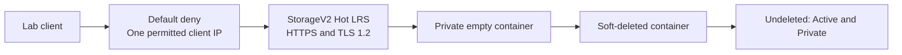

# Azure Storage Security & Container Recovery

A disposable Azure lab that demonstrates a real firewall denial, narrowly allowed client access, and recovery of a deleted **empty private container**. Executed 15–16 October 2026 in North Europe; the storage account and its resource group were deleted afterward.

**Scope boundary:** file upload could not be completed through the browser's file picker. No blob was uploaded, downloaded, deleted or recovered. This repository does not claim file integrity verification, ransomware recovery or a backup restore.

## Results

| Exercise | Evidence class | Observed result |
|---|---|---|
| Access before adding a client rule | Actual data-plane request | HTTP 403; portal identified the storage firewall restriction |
| Access after adding one client IPv4 rule | Actual data-plane request | Container contents could be listed; zero items |
| Default-deny firewall with no trusted-service exception | Actual resource configuration | `defaultAction=Deny`, `bypass=None`, one IP rule |
| HTTPS, TLS 1.2, anonymous blob access disabled | Actual resource configuration | Confirmed in the account resource JSON |
| Delete and undelete `recovery-test` | Actual container operation | Active → Deleted → Active; private access preserved |
| Blob and container retention | Portal configuration | Both enabled for seven days; blob recovery not exercised |
| Cleanup | Actual management-plane operation | Azure reported group deletion; resource view showed 0 of 0 |

The account used Standard StorageV2 / Hot / LRS. There were no VMs, private endpoints, paid Defender plans or backup services. Public network access remained enabled **for selected IP addresses**, not unrestricted internet access. Shared Key access remained enabled; this lab is not an Entra-only or least-privilege identity implementation.



## Inspect the evidence

- [Sanitized final account configuration](evidence/account-final.sanitized.json): selected fields from the actual resource response, not a deployment template.
- [Observed test results](evidence/observations.json): a transcription of portal results, with evidence classes and limitations.
- [Evidence provenance](docs/EVIDENCE.md): capture method, redaction policy and verification limits.
- [Execution and reproduction notes](docs/RUNBOOK.md).
- [Cost and cleanup record](docs/COST-AND-CLEANUP.md).

Run the local configuration check with Python 3:

```text
python scripts/check_configuration.py
python scripts/check_configuration.py --self-test
```

These commands read the saved evidence and make no Azure requests. Passing them means the captured configuration matches this lab's declared controls; it does not retest live Azure behavior. A generated report is in [evidence/local-validation.json](evidence/local-validation.json).

## Limitations and next steps

- The restored container was empty. The prepared 203-byte canary is retained in `sample-data/` as an **unexecuted input**, not recovered evidence.
- No anonymous HTTP request, obsolete TLS handshake or HTTP-only request was tested; their restrictions were verified as configuration only.
- The portal used its Access key authentication mode with existing access. No key or SAS was displayed, exported or published, and no role assignment was created.
- Soft delete inside the same account is not an independent backup. Microsoft explains that [container soft delete does not protect against account deletion](https://learn.microsoft.com/en-us/azure/storage/blobs/soft-delete-container-overview).
- Interrupted work caused the empty account to remain for about ten hours. This missed the planned same-session cleanup target; the full deviation and confirmed cleanup are recorded.
- A future content-recovery exercise would require an approved working upload path, a real payload, download/hash comparison, and immediate cleanup. That exercise has not been run.

Related completed work: [Azure Policy Guardrails](https://github.com/babbasassy/atlas-azure-policy-guardrails-lab) and [Azure Network Segmentation](https://github.com/babbasassy/atlas-azure-network-segmentation-lab).
